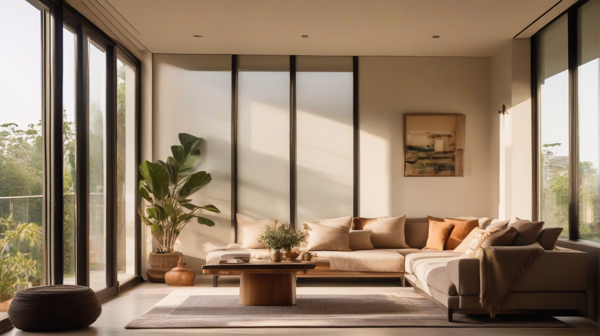

# Why 3 BHK Homes Are the Smarter, More Practical Choice for India’s Growing Families

*Discover why 3 BHK homes are a practical choice for Indian families. Learn how flexible spaces, school access, and avoiding upgrade costs benefit daily life.*

*A bright, airy living space designed for modern family life in India. — Illustration (AI-generated)*

You’re probably weighing whether a 3 BHK home fits your budget and your family’s daily rhythm. For modern Indian households juggling school runs, work-from-home days, study time and visiting parents, 3 BHK homes offer adaptable rooms, greater privacy and a more efficient long-term housing path than starting small and upgrading later.

## Key takeaways

- 3 BHK homes reduce daily compromise in shared spaces like living rooms.
- The third bedroom transitions from nursery to study or guest room as needs change.
- Buying a 3 BHK upfront can avoid resale pressure and relocation costs.
- Verify schools, healthcare and safe open space before choosing a 3 BHK.
- Check layout, ventilation, storage and total ownership costs before buying.

## Why 3 BHK homes suit the way Indian families live now

In a 2 BHK, the living room often doubles as a study, a play zone and a guest area, and someone is always rearranging furniture. A well-planned 3 BHK removes that daily negotiation. One bedroom becomes a quiet study or work nook, another serves the children, and the master keeps parents rested.

The result is less crowding, fewer arguments over shared space and a home that actually supports routines instead of fighting them. Over time, that adaptability matters more than square footage alone.

## 3 BHK homes at a glance: what changes for a growing family

| Household need | 2 BHK impact | 3 BHK benefit |
| --- | --- | --- |
| Simultaneous activities | Living room overcrowded | Dedicated rooms reduce overlap |
| Children’s privacy | Shared bedroom or living area | Own bedroom supports growth |
| Shared-space pressure | High during study or WFH | Spreads across multiple rooms |
| Future flexibility | Limited reconfiguration | Third room adapts to new needs |
| Long-term livability | Frequent reorganization | Stable layout reduces stress |

A 3 BHK does not guarantee perfect proportions, but it gives families room to breathe without constant compromise.

## The third bedroom: nursery today, study or guest room tomorrow

The third bedroom is the most versatile room in a 3 BHK. Today it may hold a crib and toys; tomorrow it can become a study, a home office or a quiet reading corner. When grandparents visit, it becomes a proper guest room without converting the living area.

This transition happens without major renovation or moving, which keeps routines stable for children and reduces the pressure to upgrade. The room’s value grows with the family rather than being fixed at purchase.

## Flexible rooms and private space keep the living room from becoming an overflow zone

- **Work-from-home zone:** A bedroom or alcove can host a desk without disturbing family time.
- **Study area:** Children get a quiet corner instead of the dining table.
- **Personal space:** Each family member can retreat, reducing friction.
- **Guest accommodation:** Visitors stay in a bedroom, not the living room.
- **Reduced congestion:** Activities spread across rooms instead of piling into one space.

The benefit depends on room proportions and circulation. A narrow third bedroom may not work as well as a study, so layouts should be checked carefully.

## Why buying a 3 BHK upfront can beat the upgrade cycle

| Cost factor | Starting in a 2 BHK | Buying a 3 BHK now |
| --- | --- | --- |
| Resale pressure | Sell under time pressure | Avoid forced sale timing |
| Brokerage | Paid twice (buy and sell) | Paid once |
| Registration | Two sets of fees | One set of fees |
| Moving expenses | Packing, transport, downtime | One move only |
| Emotional cost | Disruption to children and routines | Stability from day one |

Buying a 3 BHK upfront is not always cheaper, but it can be financially smoother. Affordability remains the key caveat, and budgets should account for total ownership costs.

## Check schools, healthcare and safe open space before choosing a 3 BHK

- **School runs:** Walk or cycle routes matter more than distance on a map.
- **Healthcare:** Government hospital Tamia is about 1.0 km away in a straight line, but verify actual access.
- **Safe open space:** Look for play areas and walking paths within the neighborhood.
- **Traffic and errands:** Check peak-hour movement for groceries, banking and clinics.
- **Daily routines:** Visit at different times to feel the rhythm of the area.

Straight-line distances do not equal commute times, and free-flow travel estimates are not rush-hour journeys.

## Before you buy a 3 BHK: verify the layout, project and full financial picture

- [ ] Check actual room dimensions, not just carpet area.
- [ ] Confirm usable area matches your furniture plans.
- [ ] Verify ventilation and daylight in every room.
- [ ] Inspect storage space and built-in wardrobes.
- [ ] Test work-from-home suitability of the third bedroom.
- [ ] Review children’s safety features and balcony barriers.
- [ ] List included amenities and their maintenance charges.
- [ ] Confirm RERA approvals and project legal clearances.
- [ ] Validate possession timeline against your plans.
- [ ] Calculate total ownership costs, including EMIs and upkeep.
- [ ] Visit the site and review official documents before deciding.

Project-specific claims should be verified through official documents and a site visit rather than general marketing material.

## Frequently asked questions

### Is a 3 BHK worth the extra cost compared to a 2 BHK?

It depends on your family’s routines and budget. A 3 BHK reduces daily compromise and avoids future upgrade costs, but only if you can comfortably service the loan and maintain the home.

### Can the third bedroom really work as a study or office?

Yes, if the room has adequate light, ventilation and proportions. Narrow or poorly placed rooms may feel cramped, so check dimensions and layout during the site visit.

### How do I know if a 3 BHR layout suits my family?

Walk through with your daily schedule in mind. See whether work, study and guest needs can coexist without turning the living room into an overflow zone.

## Who should buy a 3 BHK now, and who should look elsewhere

A 3 BHK suits families expecting growth, regular guests or sustained work-from-home needs. It is less ideal for single earners or couples whose routines fit comfortably in a 2 BHK. Before deciding, verify the layout, location access and total ownership costs.

## Plan your 3 BHK visit today

If a 3 BHK aligns with your family’s needs, schedule a site visit to experience the layout and surroundings firsthand. Our team can arrange a guided tour of upcoming Godrej Properties developments.

## Sources and where to verify

1. Your state's RERA portal — Where to verify project registration, approvals and the developer's record
2. [Background on the area (Wikipedia)](https://en.wikipedia.org/wiki/India) — General background, not a source for figures
3. [Reforms widen routes into Indian real estate - Law.asia](https://news.google.com/rss/articles/CBMiY0FVX3lxTFA3RUlKR0t0dWNweTlZM1VWNUtMekROUFg3NU82T0thQ3RSX2pzMTJOWWdycTlrQk14RGQ4cGFYel9GaDhmQUZuUGxIRU5aenBpY1FDWmpSRndEczNqOTJOZ1Z2NA?oc=5) — Google News, Wed, 21 Oct 2026 15:52:13 GMT
4. [India’s Office Real Estate Sector Growth in Q3 2026 | IN - Cushman &amp; Wakefield](https://news.google.com/rss/articles/CBMilwFBVV95cUxQY3J0NEZNbVRoU2pNN3lFQUR0dHhmQ190Q1l3S1pGeXpCeTRDNFR5VzU3UFl5dXdmeFpES2w4bTlEbGROMTJVcmU2bGNQOEJRNUhyTzlrS0ZPaEhrNi0wZXdFbGdvRFUxQ09vcDFaQ0tleVY0dnN0VmMyRlpUYXZHYXVrLVgxTWx1QUowbEd2TVEtSGVVV1Nz?oc=5) — Google News, Tue, 13 Oct 2026 07:00:00 GMT
5. [Tier-2 Pivot: Why Retirement Real Estate Is Moving Beyond India’s Megacities - Outlook Money](https://news.google.com/rss/articles/CBMitAFBVV95cUxQVmdPanYxdnBON1dLejJZeXZWNFNuSkxCQnJGeTRSMHRRRHNOWnFoS1A3NFk0STE4ZC0yMzNGdnpuaFBCSU5hdnJSODk1ckM1Zm5oVENSSGpRejRJeGxYYzYxVEtxNWxGRXNLcm1nTDhtQklzYUk1dkJGSlVsajVZLXVjVDZ0LW5hcnFfNDhDSElMY3YtVnVQeThwQjFtOVp5ZkFHclNrU1hKTXFSZEJBQjdoa0bSAcIBQVVfeXFMTkUzaW5kcXFXZHp1cjRkSWcxVl9nRGdLaV9pcTc1S2dET1FKQ2VWNlNwb0ZNU0R2MnBjYnN6Sm1OT3pySzkxWHVMclFVYW5PcHRjbU1TSWJsd3dwNlRITl9VSlVzWEp2TU14Sy1vaEpEWTI0ZUZnZFpSdkdqUzJhRDNKQ0Q3LXM5S2R2dUktcGVNeVhMLUNkcGdiYWw0cFBlZDFCQnZkTkVCVVRhS0RGT0VOSlNrRW9XZjBvRm9HRGh5cXc?oc=5) — Google News, Tue, 20 Oct 2026 08:39:46 GMT
6. [India’s flexible office stock projected to reach 160 million sq ft by 2030 - Construction World](https://news.google.com/rss/articles/CBMi7gFBVV95cUxPM2dxTXZLS0NrNF9qUEFCcWtGbGtCSm1wX205MDdjSHc3NGF6X0VjVlVlb1ZiN2RUQTlOcWhVTndDSHRDNWthRlJUM1V4LTg3dlRnNk9nVHdnblBRYjBuTjF4ejNHY2twZTlLUnphek5Za1k1cGVNQWVGWEZYWHdJQWF1ZFhWcWlaYThXZkhCLXdFbTVPM0NlOUxiQkpEeEFpbVZHRjlhZkJkR0hEdWRkeHBIUDNoazFKQzAtbkxVWTRjYWZEVTAwUDdsVVJ3Z0VXT2JmMGttQ1FhTHU1RWR4TzRYdUU2RDE5NEFpNVJ3?oc=5) — Google News, Wed, 21 Oct 2026 15:31:50 GMT
7. [OpenStreetMap](https://www.openstreetmap.org) — Nearby places and straight-line distances
8. [OSRM road routing (Project OSRM)](https://project-osrm.org) — Road distances and free-flow travel times
9. Facts supplied by Godrej Properties Limited — Project and local figures provided with this article's brief

Topics: India, Buyer's guide, 3 bhk homes, Indian families, Real estate, Property buying guide
