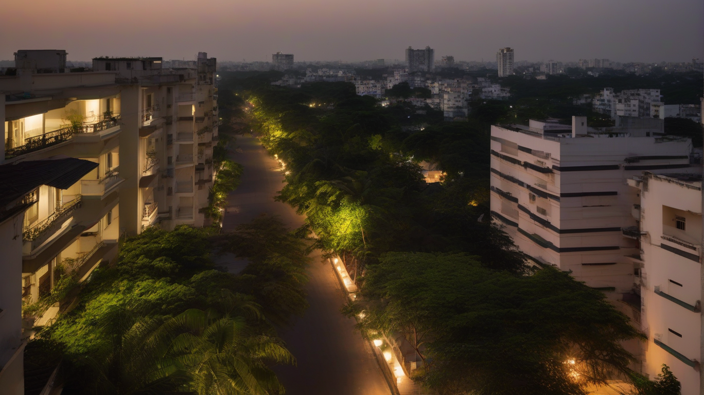

# Budwel luxury living: why families and investors are betting on Hyderabad's western corridor

*Discover why families and investors choose Budwel luxury living. Learn about Prestige Spring Heights, ORR connectivity, schools, and infrastructure.*

*Dusk settling over the upscale residential expanse of Hyderabad's western corridor. — Illustration (AI-generated)*

Budwel luxury living isn't just about premium finishes — it's about whether your daily life actually works. For families weighing school runs, healthcare access, and weekend safety, and for investors watching infrastructure move from announcement to reality, the western corridor demands a closer look. Budwel sits roughly 300 metres from the Outer Ring Road (ORR), placing it near major IT hubs while still offering green buffers and planned arterial roads.

The question isn't whether it's upscale — it's whether the lifestyle and investment case hold up under scrutiny.

## Key takeaways

- Budwel sits about 300 metres from ORR, cutting travel time to IT hubs.
- Planned 120-ft and 150-ft arterial roads improve daily commute reliability.
- Prestige Spring Heights anchors a mixed-use ecosystem at Plot Nos. 9 and 10.
- Government-led infrastructure includes underground utilities and lakefront ecology.
- Verify RERA registration, HMDA layout approval, and title clarity before investing.

## Budwel luxury living: the investment case at a glance

| Factor | Detail |
| --- | --- |
| ORR Proximity | About 300 metres from Outer Ring Road |
| Arterial Roads | Planned 120-ft and 150-ft roads per HMDA layout |
| Project | Prestige Spring Heights at Plot Nos. 9 and 10 |
| Land Use | Part of 182-acre HMDA-approved greenfield layout |
| Regulatory | Covered under TG-RERA for project registration |

## Why families choose Budwel: schools, healthcare, and safe green space

- **Schools:** Government High School (~1.3 km), Noble School (~1.7 km), ZP High School (~2.0 km), Pranathi Vidyalaya (~2.3 km), Rock School (~2.6 km)
- **Healthcare:** Community Health Centre Rajendranagar (~1.0 km), NIRD Health Centre (~1.4 km)
- **Green Spaces:** Rural Technology Park (~0.9 km), Eco Park Hyderabad (~2.0 km), Singhs Park Cricket Ground (~2.0 km), Sai Baba Nagar Colony Park (~2.6 km)
- **Daily Needs:** General store/supermarket (~2.4 km)

## Connectivity that cuts commute: 300 metres to ORR and arterial roads to IT hubs

The planned 120-ft and 150-ft arterial roads reduce bottlenecks, especially during peak hours. While exact commute times vary with traffic, the road hierarchy ensures fewer signal delays compared to older Hyderabad suburbs. For investors, this connectivity supports long-term demand from IT professionals seeking proximity without city-centre premiums.

## Infrastructure you can see: HMDA masterplan, underground utilities, and lakefront ecology

| Upgrade | Status |
| --- | --- |
| HMDA Masterplan | Budwel zone included in revised master plan |
| Underground Utilities | Planned as part of layout design |
| Lakefront Ecology | Adjacent to natural water bodies and eco-sensitive zones |
| Road Structure | 120-ft and 150-ft arterial roads laid out per plan |
| Layout Approval | 182-acre greenfield development approved by HMDA |

These upgrades are visible in planning documents and reduce the risk of future disruption to daily life or property values.

## Prestige Spring Heights: a self-sustained urban ecosystem at Plot Nos. 9 and 10

Prestige Spring Heights is positioned at Plot Nos. 9 and 10 within the Budwel layout, designed as a mixed-use development combining residential towers with retail and community spaces. The project emphasizes walkability, with essential services clustered to minimize dependency on vehicles.

Its placement within the HMDA-approved layout ensures alignment with broader infrastructure plans, including road widening and utility upgrades. For residents, this creates a semi-closed-loop lifestyle where work, school, and leisure are within manageable distance.

## Catalysts to watch: announced projects vs. operational reality

Two key projects are shaping Budwel's future trajectory. The Budvel Trumpet, for which HMDA has prepared a detailed project report (DPR) at an estimated cost of ₹488 crore, aims to improve regional connectivity. Separately, the NH167N expansion — a greenfield highway linking Budvel to Kosgi — has been announced to transform the southern corridor.

While both are confirmed in official announcements, construction timelines remain fluid. Investors should treat these as upside potential rather than guaranteed near-term catalysts.

## Risks that could weaken the lifestyle and investment case

- **Liquidity:** Secondary market activity in Budwel remains limited, affecting resale speed.
- **Supply Pipeline:** Multiple developers are launching projects simultaneously, risking oversupply.
- **Delivery Timelines:** Delays in large-scale developments can impact occupancy and rental yields.
- **Regulatory Dependencies:** Final HMDA approvals and utility connections may face bureaucratic lag.
- **Traffic Evolution:** Current low congestion may not persist once ORR-linked projects go live.

These factors require active monitoring, particularly for investors relying on rental income or quick exits.

## An investor's due-diligence checklist for Budwel

- [ ] Confirm RERA registration status via https://rera.telangana.gov.in/
- [ ] Verify HMDA layout approval for the specific plot or project
- [ ] Check title clarity and encumbrance certificates through sub-registrar records
- [ ] Review possession timeline and payment schedule against RERA norms
- [ ] Assess proximity to operational infrastructure (schools, hospitals, roads)
- [ ] Evaluate developer track record and past project delivery history
- [ ] Factor in ongoing traffic and upcoming road expansion impacts

Completing this checklist helps separate speculative interest from informed investment.

## Frequently asked questions

### Is Budwel a good place to live with children?

Yes, if you prioritize access to schools and parks. However, public transport options are still developing, so private vehicle use remains necessary for most errands.

### How does Budwel compare to other Hyderabad suburbs for investment?

Budwel offers lower entry costs than established areas like Banjarah Hills or Jubilee Hills, with comparable infrastructure potential. Its proximity to ORR and planned road expansions make it attractive for early-stage investors willing to accept some execution risk.

### What should I verify before buying in Prestige Spring Heights?

Start with RERA registration and HMDA layout approval. Also confirm the project’s sanctioned plan matches what’s advertised, and check the developer’s history on similar developments. Title verification through the sub-registrar office is critical.

## Who Budwel suits — and who should look elsewhere

Budwel luxury living works best for families who want space and greenery without being far from IT corridors, and for investors comfortable with a 3–5 year horizon. It suits those who value planned infrastructure over immediate urban buzz. It does not suit buyers needing instant walkability to cafes, malls, or metro rail.

The first thing to check: confirm RERA registration and HMDA layout approval for any specific project before committing capital.

## Enquire now about Prestige Spring Heights

If Budwel aligns with your lifestyle or investment goals, enquire now to speak with a representative about current availability and pricing at Prestige Spring Heights.

## Sources and where to verify

1. The Telangana RERA portal — Where to verify project registration, approvals and the developer's record
2. [Telangana](https://rera.telangana.gov.in/) — TG-RERA To promote transparency in the real estate sector by maintaining an online platform for project registration and information dissemination.
3. [Masterplan Huda - Hyderabad Metropolitan Development Authority](https://www.hmda.gov.in/masterplan-huda/) — Masterplan Huda Home Page Revised Master Plan Zone Wise Plans ZONAL WISE LIST Sl.NO DISTRICT IMAGE 1 BUDVEL ZONE CLICK TO VIEW 2 CHENGICHERLA ZONE SHEET 1 CLICK TO VIEW 3 CHENGICHERLA ZONE SHEET 2 CLICK TO VIEW 4 GHATKESAR CLICK TO VIEW 5 GHATKESAR CLICK TO VIEW 6 HAYATHNAGAR ZONE SHEET1 CLICK TO VI
4. [PDF 10x15_HMDA_Budwel](https://www.hmda.gov.in/wp-content/uploads/2020/07/Budvel.pdf) — 182 ACRES OF LIMITLESS OPPORTUNITY 100 ACRES PLOT AREA FOR AUCTION PROPERTY ON WESTERN CORRIDOR OF HYDERABAD Join us on an incredible journey of growth and development at this greenfield city, planned across 182 acres in Budwel (V), Rajendranagar (M). The layout will be one of the most modern space 
5. [Planning - Hyderabad Metropolitan Development Authority](https://dev.hmda.gov.in/planning/) — Planning Home Page Planning Department Planning Permissions Online DPMS Layout/ Building Permissions/ Land use/ oc Layout Permissions Building Permissions NOCs Municipal Extended Huda Area Layout Permissions Building Permissions NOCs Singel Window Industrial Building Permission for Single Window Cas
6. [Background on the area (Wikipedia)](https://en.wikipedia.org/wiki/Rajendranagar_mandal) — General background, not a source for figures
7. [Hyderabad real estate boom: Thorrur plots sold at whopping ₹45,500 per sq yard in record auction - The Times of India](https://news.google.com/rss/articles/CBMiggJBVV95cUxOUjZnZUphSWIyQ2I0T0M5N2V6OXprNG1mYmVGaXVVc1JfcU43dTRtZTVQZHNVZzd6ZFkzTFlXc0ZTU3ByTFBCTDVFVldBQ0dLNlpVRm5aN2YxWW5wa3NZdzhJZ2JBZ2tGa3Nuak9sVFc1dXVWUFo3bXhtYnJ6eFVfTDRaelh1bXRwX1Ftb0YwOE1peU11WnkzVkVrWk5zOUhFbFY4bThIc0RFTWZLMGM1bjBJZFNXSzJNMDNhQkhrUDZFVGNiRzRYWW0yMGxhZ1NwcFRtWHFrc0o1YWRSTnRnLVZ4V2N3MEJ6Mi1jRzBrS2ZnQld1QzFpNmphLWFqaGNIYkHSAYcCQVVfeXFMT3R6TFJkRDJvX3BRVEdqNE5MdmN6aUI1aG1FeFBDQ2YwNnFuenJoVjByN2RTUnlVTDlHcXV3WVpVYUpGSE1aVHlDV3U1Ujd5ZDVQQW16VTdLTHF2Rll4ekpWSE1oY0s1a1lPY1dHVXBaQzMtUHQ1VmpqS1A0VXB5bHh2Mk1mS2dlaTZPTmNsWUVwaFJoSldfWExPT1ZJVmhXUl95emcwQVp0Q0FiX2tyX0ptdUdnNG5mWnpibWh1ZTNQLXZqblVmUmZFdzl6OUc0T3JZUnA2NXJjV3Q4eW1TLW5sYzM5allkb3NuTVpmdE5EUUotQjJIWndjME5sN1BQZGwzWnhVZEU?oc=5) — Google News, Tue, 19 May 2026 07:00:00 GMT
8. [Rocks flattened at Budvel to make way for high-rises - The Times of India](https://news.google.com/rss/articles/CBMiyAFBVV95cUxNSmN3STNSNkx1eXVuQWNaekZxVEktOUJrcWY1NWREUS05bV9FeXZxT011N1NmaHFaXy1ZemtrMTE1Q29wZzg4Q0xQY1UybXNjQS1XRjJDal96TmZWRmwwenkyTXBJUVFVbGhMWld2dFhJOEsxSVBfLUpMSWZMU1dBRFljMlQzMm5fOUttdDFwVUFwNFVRZFhyZWdSSnI5SzdON2RkeDZBWXFERExPVDVnSnVHSi1hTGJSRTNqczRPUWx0WXFSNU01WdIBzgFBVV95cUxPODA1STJnMlVSRVhVdXlWLWxwSERzR01WQUFTcENGdzRGX1F1MDZxRENpOVdJZzdzM3RoYWhHS1VJcFhpSXc0ZDFGNUt3WEl4QnhSV0t6QmRnZWJ6Z1NIbFFzZ29XcllfdC1LRDJFNHg3ZzkzNVNubTVDX01VWUludlg0bG5SczZFQWlEdlI4YkxTOVp5bE1qUEE1ODYybTZFdmhvYklSSUJGR3dnemJiMlRRcjU3M1ByWFNvbzFCX01wOUFZczE5d1pDZmQyZw?oc=5) — Google News, Tue, 04 Feb 2025 08:00:00 GMT
9. [Seven New Roads to Connect ORR with Musi Corridor, Aiming to Ease Traffic - Telangana Tribune](https://news.google.com/rss/articles/CBMiqgFBVV95cUxOZG93TnhLOHZFa0FBbVc4ZjE4dEhrT2RGSXhQRjhfOVpxcUlwTFp5aE9DQ3VpVlI3bUloa0M1X0p4SGtJLTYxaW5NbjdEdDUweFZobFZQMUttVVlfOW9OdlVObmJ6b1JkUVFOa3ExV1J5by1LcENiTE8zRnBDNzA0MUh4UHFKeFVuenlUeHA1QnVsaV94S1I1T052TEdOZm9PLTk0RURHRVFtZw?oc=5) — Google News, Fri, 01 May 2026 07:00:00 GMT
10. [Budvel Trumpet: HMDA Prepares DPR for Rs 488 Crore Project - Sakshi Post](https://news.google.com/rss/articles/CBMiuwFBVV95cUxOVDNxWWRDc3RSUUtSMzdsZi05LWZSM3loOWs1WWszcXJRWW1YVkxRR2hjY2hncnNaYU5ndVpva25jdEFSWFJzTUtTMFZMY3JvU3pTQVNRSU5HUVExM0c5NmZDY1ZCREw4SmIxbnhEQnRUdlRJMVd0WGZwenMxZHFGN25wVGdkeXBiak9hSzhwWlJmcjV1WWRwT01ydzdnWG45d1ZoRW1oMjlYOWhHRTd3US1vNDZ5TzNOSW400gG-AUFVX3lxTE94NURHSHlvWThCbTFMT1FWemhfVUhtanVoemprTzRvY3VNTW9iQmtDUXlzeTJWVWJiVFExajEtWjJtYkdxMWZBWGZHWmpUcjFJUHZJYVcwbjAyYWkxZmJFS3YyeGJ0YzkzTE9QR04ydDZvT1NxbGM4c1hPTXAxbXVSZjVCcTZhTWRuajVlQUVxNlBvaDdjdEdrcDhvOWQyV3NyRDFwZ3dSSmVGdGc1aU4xVzlIV1dIT3JTTmczTHc?oc=5) — Google News, Thu, 15 Jan 2026 08:00:00 GMT
11. [OpenStreetMap](https://www.openstreetmap.org) — Nearby places and straight-line distances
12. [OSRM road routing (Project OSRM)](https://project-osrm.org) — Road distances and free-flow travel times
13. Facts supplied by Prestige Constructions — Project and local figures provided with this article's brief

Topics: Budwel, Hyderabad, Investment analysis, Budwel Hyderabad, Prestige Constructions, Luxury living
